# AI FAQ Assistant

A modular PostgreSQL + pgvector + Gemini RAG project for semantic FAQ search and retrieval.

This project stores FAQ records in PostgreSQL, generates embeddings with Gemini, and performs similarity search using pgvector so users can query the knowledge base by meaning rather than exact keyword match.

<a id="contents"></a>
## Contents and day-by-day progress

| Section | Overview / progress |
| --- | --- |
| [Why this project exists](#why-this-project-exists) | Motivation for semantic FAQ search. |
| [Features](#features) | Main project capabilities. |
| [Tech stack](#tech-stack) | Languages, services, and libraries used. |
| [Project structure](#project-structure) | Repository layout. |
| [Prerequisites](#prerequisites) | Required software and credentials. |
| [Local setup](#local-setup) | Installation and configuration steps. |
| [Run the application](#run-the-application) | How to start the CLI. |
| [Data flow](#data-flow) | High-level RAG pipeline. |
| [Testing](#testing) | Test suite and how to run it. |
| [Notes for public GitHub use](#notes-for-public-github-use) | Credential and repository guidance. |
| [Development progress](#development-progress) — [Day 1](#day-1) | **Basic FAQ RAG baseline:** JSON ingestion, Gemini embeddings, PostgreSQL/pgvector semantic retrieval, and context-based answer generation through a CLI. |
| [Day 2 — Document ingestion and chunking](#day-2-progress) | **Progress:** versioned synthetic policies, seven chunking strategies, provenance, and offline structural comparison. |
| [Day 3 — Persistent document ingestion and retrieval](#day-3-progress) | **Verified:** idempotent PostgreSQL/pgvector chunk storage, provenance-aware retrieval, explicit version filters, and real database integration tests. |

## Why this project exists

Traditional keyword search fails when users ask questions with different wording than the source content. This assistant uses embeddings to convert both the FAQ and the user question into vectors and then finds the closest semantic matches in PostgreSQL.

[Back to index](#contents)

## Features

- FAQ dataset ingestion from JSON into PostgreSQL
- Gemini embedding generation for each FAQ and user question
- Gemini-generated, Markdown-formatted answers grounded in retrieved FAQs
- pgvector similarity search using cosine distance
- modular Python package structure
- CLI for ingesting data and asking questions
- document parsing and chunking strategy comparison with source provenance
- versioned document-chunk ingestion and provenance-aware pgvector retrieval
- production-oriented project layout for portfolio and GitHub use

[Back to index](#contents)

## Tech stack

- Python 3.13+
- PostgreSQL
- pgvector extension
- Google Gemini embeddings
- psycopg2
- Python-dotenv

[Back to index](#contents)

## Project structure

```text
ai_faq_assistant/
├── app/
│   ├── __init__.py
│   ├── chunking/
│   │   ├── __init__.py
│   │   ├── corpus.py
│   │   ├── demo.py
│   │   ├── evaluation.py
│   │   ├── markdown.py
│   │   ├── strategies.py
│   │   └── types.py
│   ├── config/
│   │   ├── __init__.py
│   │   └── settings.py
│   ├── domain/
│   │   ├── __init__.py
│   │   └── faq.py
│   ├── infrastructure/
│   │   ├── __init__.py
│   │   ├── database.py
│   │   ├── document_chunk_repository.py
│   │   ├── embedding_client.py
│   │   └── faq_repository.py
│   ├── ingestion/
│   │   ├── __init__.py
│   │   ├── document_ingestion.py
│   │   └── ingestion.py
│   ├── retrieval/
│   │   ├── __init__.py
│   │   └── retrieval.py
│   ├── services/
│   │   ├── __init__.py
│   │   ├── AI_assistant_service.py
│   │   ├── faq_ingestion_service.py
│   │   └── rag_service.py
├── data/
│   ├── faqs.json
│   └── policies/
│       ├── manifest.json
│       ├── remote_work_v1.md
│       ├── remote_work_v2.md
│       └── travel_expense_v1.md
├── sql/
│   ├── 001_enable_pgvector.sql
│   ├── 002_create_faq_table.sql
│   ├── 003_vector_search.sql
│   ├── 004_insert_sample_faqs.sql
│   └── 005_create_document_chunks.sql
├── tests/
│   ├── test_chunking.py
│   ├── test_core.py
│   ├── test_document_storage.py
│   └── integration/
│       └── test_document_postgres.py
├── .env.example
├── .gitignore
├── Dockerfile
├── README.md
├── main.py
├── pyproject.toml
├── requirements.txt
└── uv.lock
```

[Back to index](#contents)

## Prerequisites

Before running the project, make sure you have:

1. Python 3.13 installed
2. PostgreSQL installed and running
3. pgvector enabled in your database
4. A Gemini API key

[Back to index](#contents)

## Local setup

### 1) Clone the repository

```bash
git clone https://github.com/nandinikori/FAQ_Assistant_Using_RAG.git
cd FAQ_Assistant_Using_RAG
```

### 2) Create a virtual environment

```bash
python -m venv .venv

# Windows
.venv\Scripts\activate

# macOS/Linux
source .venv/bin/activate
```

### 3) Install dependencies

```bash
pip install --upgrade pip
pip install -r requirements.txt
```

Alternatively, with uv:

```bash
uv sync
```

### 4) Configure environment variables

Create a `.env` file in the project root based on `.env.example`:

```env
GEMINI_API_KEY=your_gemini_api_key_here
GEMINI_TEXT_MODEL=gemini-2.5-flash
GEMINI_EMBEDDING_MODEL=gemini-embedding-001
EMBEDDING_DIMENSIONS=3072
EMBEDDING_CONFIGURATION_VERSION=gemini-embedding-v1
DB_HOST=localhost
DB_NAME=ai_workshop
DB_USER=postgres
DB_PASSWORD=your_postgres_password
DB_PORT=5432
APP_ENV=development
```

### 5) Set up PostgreSQL and pgvector

Connect to your PostgreSQL database and enable the extension:

```sql
CREATE EXTENSION IF NOT EXISTS vector;
```

Then create the knowledge base if needed:

```sql
CREATE DATABASE ai_workshop;
```

[Back to index](#contents)

## Run the application

From the project root:

```bash
python main.py
```

The CLI menu supports:

1. Ingest FAQ data into PostgreSQL
2. Retrieve and display matching FAQs without AI generation
3. Ask Gemini to format an answer using retrieved FAQ context
4. Exit

To run the sample batch of FAQ questions and one open-ended question:

```bash
python -m app.services.AI_assistant_service
```

[Back to index](#contents)

## Data flow

```text
FAQ JSON file
    ↓
FAQIngestionService
    ↓
Gemini embedding generation
    ↓
PostgreSQL + pgvector storage
    ↓
Similarity search by embedding distance
    ↓
RAGService response generation
```

[Back to index](#contents)

## Testing

This project includes a minimal pytest suite to validate the main domain and service behavior.

```bash
pytest
```

The tests cover:

- settings validation
- FAQ record mapping
- JSON ingestion parsing
- repository insert logic
- service behavior for retrieval and answer assembly

[Back to index](#contents)

## Notes for public GitHub use

- Keep your `.env` file local and never commit secrets.
- Use `.env.example` as the template for contributors.
- Keep database credentials out of version control.
- This repository is structured as a clean demo/portfolio project rather than a throwaway notebook.

[Back to index](#contents)

## Development progress

This section records the repository's implementation as it evolves. Each entry describes capabilities present at that stage; planned capabilities are not counted as completed work.

<a id="day-1"></a>
### Day 1 — Basic FAQ RAG baseline

The starting implementation demonstrates the complete retrieval-augmented generation flow: load a knowledge source, retrieve relevant information by meaning, and provide that information to a language model to answer a question.

#### What is implemented

- **Ingestion:** load FAQ question–answer pairs from JSON and generate an embedding for each combined pair.
- **Storage:** persist FAQ content and embeddings in PostgreSQL with pgvector.
- **Retrieval:** embed the user's question and rank FAQ records using cosine distance. The retrieval interface defaults to five results; answer generation uses three.
- **Generation:** supply retrieved FAQ text to Gemini with instructions to answer from that information and avoid inventing facts.
- **Empty-context handling:** return a no-match message without generating an answer when no context is available.
- **Application structure:** separate configuration, domain models, database access, ingestion, retrieval, and application services.
- **Usage and testing:** provide an interactive CLI, a Dockerfile, setup instructions, and unit tests covering selected repository and service behavior with fake dependencies.

#### How the baseline works

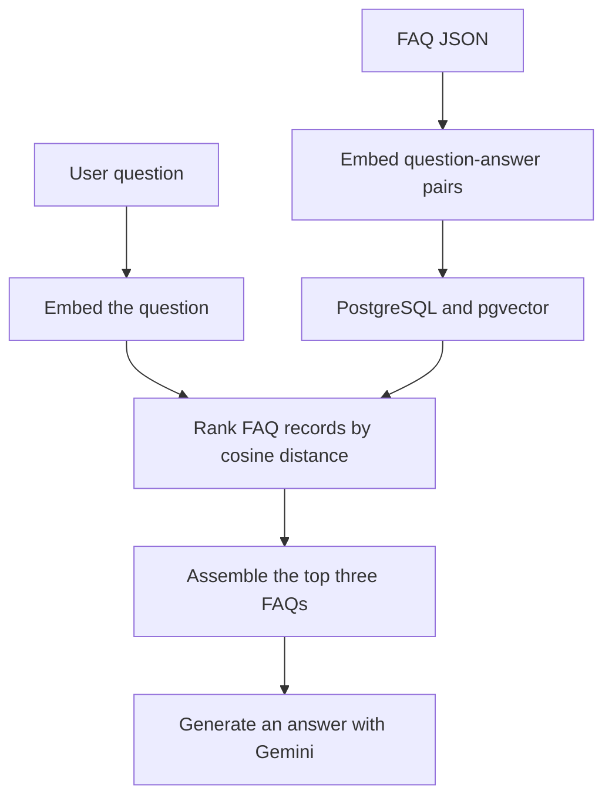

#### Concept at a glance

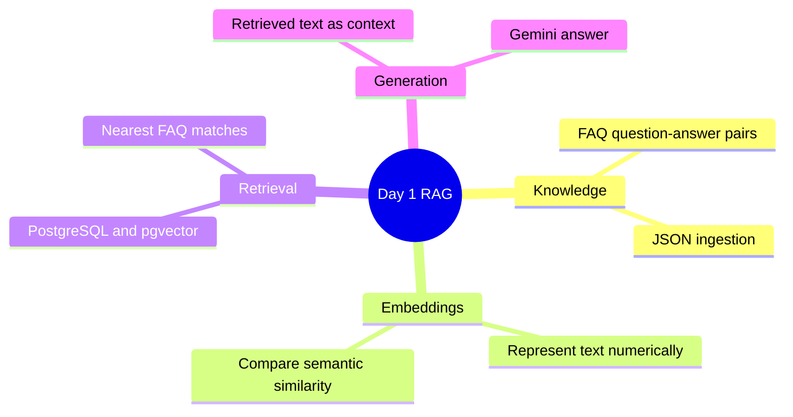

#### What this baseline establishes

A modular implementation of one dense-retrieval RAG pattern, from data ingestion to generated answers. Each FAQ pair acts as a natural retrieval unit; document chunking is not implemented at this stage.

#### Current limitations

- Retrieval returns the nearest records without a calibrated relevance or evidence-sufficiency check. Nonempty context can still be unrelated to the question.
- Repeated ingestion can create duplicate records: the method named `upsert` currently performs inserts.
- The SQL setup and application-created schema differ; the Docker Python version also differs from the project requirement.
- Hybrid retrieval, reranking, source citations, tenant authorization, and document version management are not implemented.
- There is no published retrieval/answer-quality benchmark, production monitoring, or load-test evidence.
- Existing unit tests do not establish real database integration correctness or end-to-end answer quality. This progress entry is based on source review; no application execution or benchmark was performed for this update.

[Back to index](#contents)

<a id="day-2-progress"></a>
### Day 2: Document Ingestion and Chunking

**Day 2 progress:** added a separate offline document pipeline to demonstrate and compare chunking strategies on versioned synthetic policy files. It preserves source locations and policy metadata, and includes an enterprise-style ingestion-to-retrieval architecture. The original FAQ example in `data/faqs.json` remains unchanged.

The corpus is under [`data/policies/`](./data/policies/) and includes headings, eligibility and reimbursement tables, exceptions, effective dates, and two versions of the remote-work policy.

Run the offline comparison from the project root:

```bash
python -m app.chunking.demo
```

It prints JSON metrics by document version and strategy: chunk count, average and maximum lexical-token count, target-size violations, and source-character coverage. These are structural diagnostics, **not** retrieval-quality or production-performance claims.

#### Chunking concepts and visuals

| Strategy | Boundary behavior | Best suited to |
| --- | --- | --- |
| Token window | Fixed-size windows with configurable overlap and character offsets from an injectable tokenizer. The default lexical tokenizer is deterministic but approximate; it is not a model-token billing count. | Baselines, unstructured text, and controlled size comparisons. |
| Recursive | Recursively prefers paragraph, newline, and whitespace boundaries before falling back to token-offset splits. | General text when fixed windows break useful boundaries. |
| Paragraph/sentence-aware | Packs paragraph and sentence units up to a target; splits very long sentences into token-like units. | Prose where readable boundaries matter. |
| Structure-aware | Preserves Markdown heading paths and logical blocks; keeps tables as row groups with repeated headers. | Policies, manuals, and structured knowledge. |
| Table-aware | Groups table rows and repeats the table header in every emitted row group. | Tabular rules, limits, and eligibility matrices. |
| Semantic | Splits adjacent blocks when an injected similarity score falls below a threshold, while respecting section and size boundaries. | Content with topic shifts that do not align with a fixed length. |
| Parent–child | Emits larger contextual parent chunks and smaller overlapping retrieval children linked by parent ID. | Precise retrieval with expansion to broader context. |

##### 1. Token-window chunking

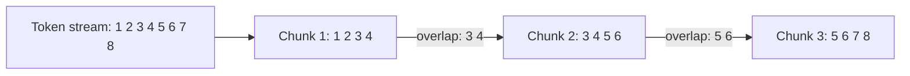

##### 2. Recursive chunking

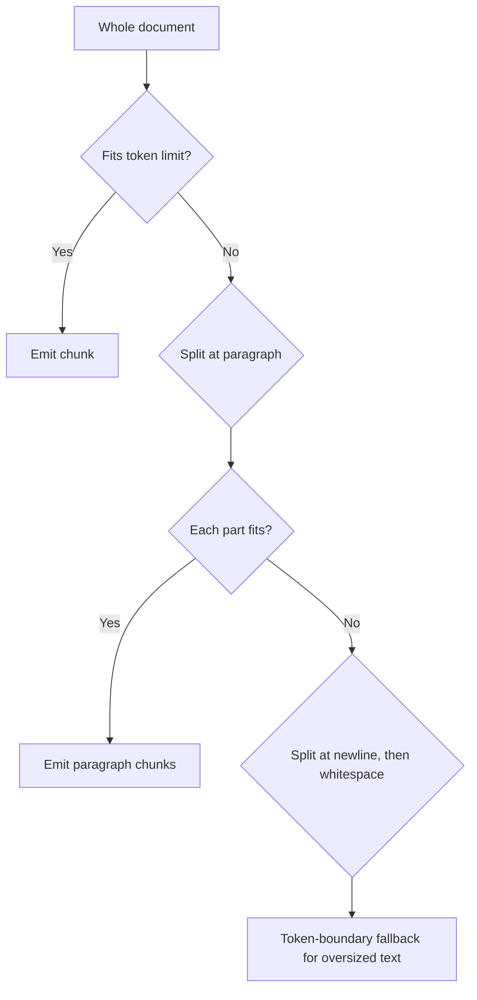

##### 3. Paragraph/sentence-aware chunking

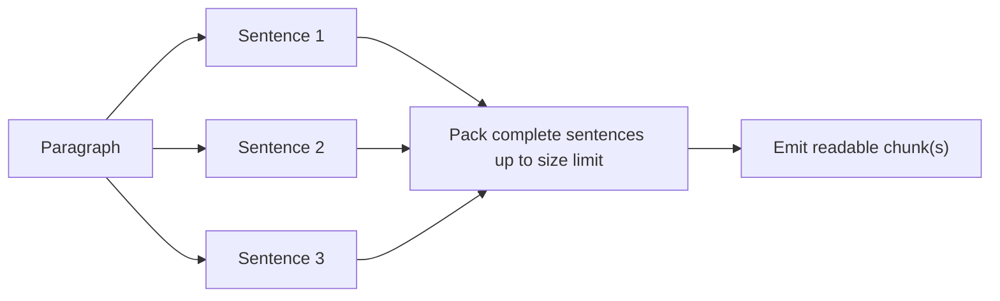

##### 4. Structure-aware chunking

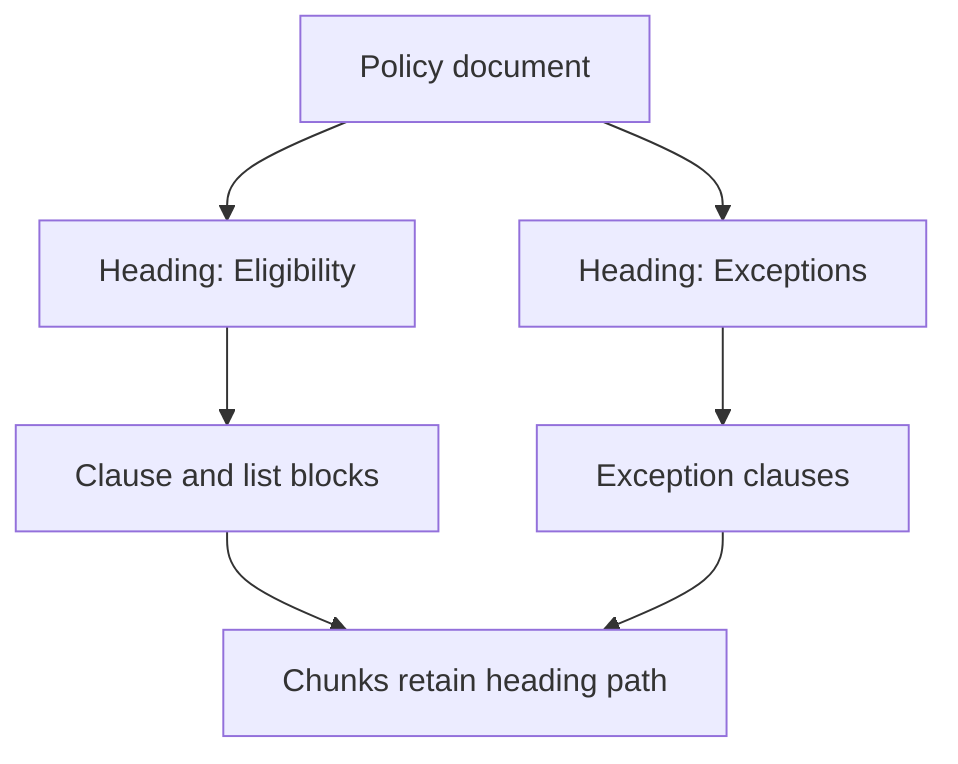

##### 5. Table-aware chunking

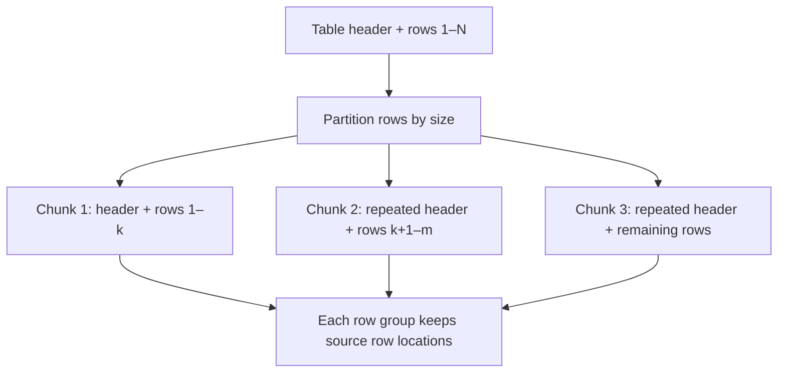

##### 6. Semantic chunking

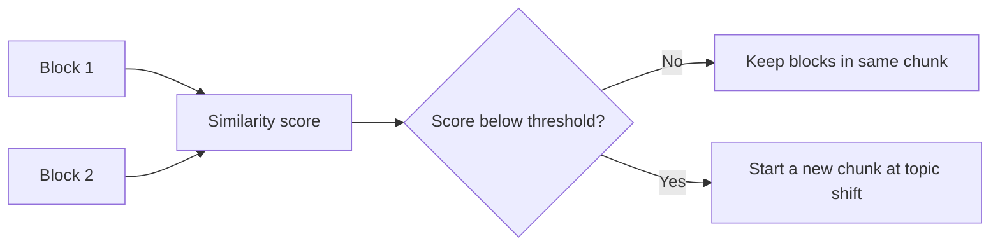

##### 7. Parent–child chunking

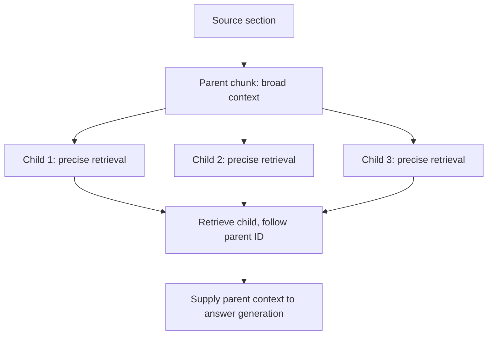

The semantic demo injects a transparent lexical-overlap proxy so it runs offline. A real system should inject cosine similarity from its selected embedding model and evaluate that boundary signal against labeled queries. The chunker interface is deliberately independent of any model provider.

This is a comparative showcase of common text chunking families, not a claim that every possible technique is implemented. Code-aware parsing, multimodal page/layout chunking, model-specific late chunking, and embedding-time contextualization are natural extensions when the corresponding source formats and model capabilities are selected.

#### Provenance and versioning

Every document carries a stable document ID, version, source name, and manifest metadata. Parsing yields typed Markdown blocks with one-based line ranges, zero-based Python character offsets, heading path, block kind, and table headers/rows. Chunks retain document version, source offsets and lines, source block IDs, heading path, strategy parameters, and (for child chunks) their parent ID. IDs are deterministic for a given source version, content, boundaries, strategy, and metadata. A new policy revision is ingested as a new version rather than overwriting history.

#### Enterprise architecture mapping

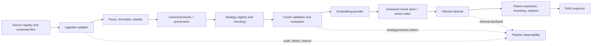

The Day 2 implementation covered the versioned corpus, Markdown parsing, chunking strategies, source lineage, deterministic IDs, and offline chunk-shape metrics. The remaining boxes describe enterprise integration points, not features claimed as already implemented. Day 3 below adds persistent chunk storage, document retrieval, and a real PostgreSQL/pgvector integration test; tenant authorization, parent expansion, reranking, and retrieval-quality evaluation remain out of scope.

<a id="day-3-progress"></a>
### Day 3 — Persistent document ingestion and retrieval

**Day 3 outcome:** policy chunks now have a persistent PostgreSQL/pgvector contract, are idempotently ingested, and can be retrieved with provenance and an explicit version filter. FAQ storage and the existing FAQ RAG methods remain available.

#### Storage and identity contract

Each `document_chunks` row stores:

- Document ID, immutable document version, source name, stable chunk ID, exact chunk text, and a SHA-256 content hash.
- Chunking strategy and configuration JSON, including the configured token limit; `token_count` is the emitted chunk's measured count from its tokenizer (the default tokenizer is a lexical approximation), not the configured limit.
- Zero-based source character offsets, one-based source lines, heading path, source block IDs, and optional parent chunk ID.
- Embedding vector, model name, dimensions, and embedding configuration version.

Chunk identity is deterministic from document ID/version, strategy, boundaries, parent identity, emitted text, and the serialized chunk metadata/configuration. Changing the chunker configuration changes the ID, so experiment rows do not overwrite each other. The storage key also includes embedding model, dimensions, and configuration version. Inserts use `ON CONFLICT DO NOTHING`; an unchanged re-ingest reuses its existing vectors. The default 3,072 dimensions match the Gemini embedding model's existing FAQ vectors. The configured vector dimension is checked before database writes and against the installed column type. A dimension change requires a separate compatible database/schema rather than mixing vectors.

All missing chunk embeddings are generated and checked before any rows from that batch are written. A failed embedding raises `ChunkIngestionError` with affected chunk IDs and aborts the batch. Database inserts then run in a single transaction. A changed source must use a new document version; old versions and alternate chunker experiments are retained.

#### Ingestion and retrieval flow

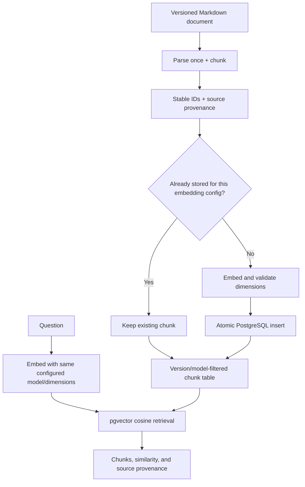

The original FAQ workflow still uses `RAGService.retrieve()` and `get_context()`. Document search is exposed as `RAGService.retrieve_document_chunks()`, with optional `document_id` and `document_version` filters.

#### Run it

From the `ai_faq_assistant` project directory, configure `.env` as shown above, start PostgreSQL with pgvector, and apply the schema migrations (the repository also ensures runtime schemas):

```bash
psql -h localhost -U postgres -d ai_workshop -f sql/001_enable_pgvector.sql -f sql/002_create_faq_table.sql -f sql/005_create_document_chunks.sql
```

Ingest both policy versions, then repeat one command to check idempotency:

```bash
python -m app.ingestion.document_ingestion --document-id remote-work --version 1.0
python -m app.ingestion.document_ingestion --document-id remote-work --version 2.0
python -m app.ingestion.document_ingestion --document-id remote-work --version 2.0
```

The repeated command reports zero new chunks and the existing chunk count. Retrieve only version 2.0 (the returned dictionaries include source name, offsets, lines, heading path, hash, and similarity):

```bash
python -c "from app.config.settings import get_settings; from app.services.rag_service import RAGService; print(RAGService(get_settings()).retrieve_document_chunks('How many days may remote employees work from home?', document_id='remote-work', document_version='2.0'))"
```

Run the unit suite with:

```bash
python -m pytest -q
```

The PostgreSQL integration test is opt-in and uses the configured database; it uses a deterministic test embedding so it does not call Gemini:

```powershell
$env:RUN_POSTGRES_INTEGRATION_TESTS = "1"
python -m pytest tests/integration/test_document_postgres.py -q
Remove-Item Env:\RUN_POSTGRES_INTEGRATION_TESTS
```

#### Verified results

- `python -m pytest -q`: **28 passed, 1 skipped** (the PostgreSQL test is opt-in).
- With `RUN_POSTGRES_INTEGRATION_TESTS=1`, `python -m pytest -q` reports **29 passed** against the local PostgreSQL/pgvector instance. It verified duplicate ingestion leaves row counts and IDs unchanged, a changed chunking configuration is stored separately, both policy versions are stored, a version-2.0 query excludes version 1.0, a wrong-sized embedding is rejected before insertion, source text/line metadata and parent IDs round-trip, and FAQ insertion/retrieval still works.

The integration embedding is deterministic and deliberately identical across chunks; it verifies the PostgreSQL/pgvector persistence and filter contract, not Gemini behavior, semantic ranking quality, or production-scale relevance.

#### Remaining limitations

- The ingestion CLI currently reads the included Markdown policy manifest; PDF, HTML, arbitrary file adapters, and source-change detection are not implemented.
- The integration test does not call the external embedding API. Live Gemini connectivity and answer quality are not established by this test.
- The configured embedding dimension is a table-level contract. Use a separate schema/database when changing dimensions; model/configuration versions with the same dimension remain isolated by query filters.
- Retrieval currently uses exact pgvector distance without an ANN index, and does not select one chunking strategy/configuration when multiple experiments are stored.
- Tenant authorization, stale-version cleanup, parent expansion, reranking, and labeled retrieval evaluation are not implemented.

[Back to index](#contents)
