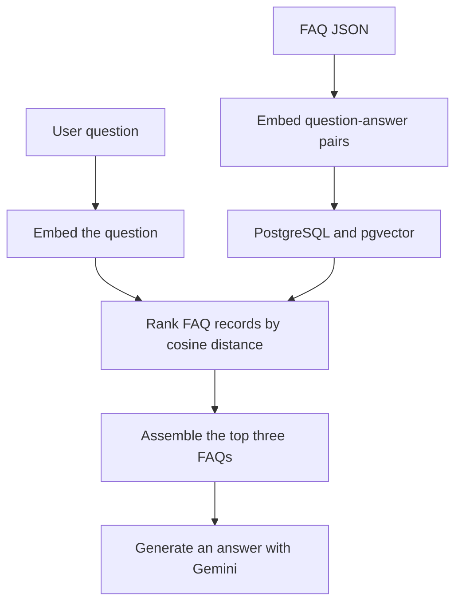
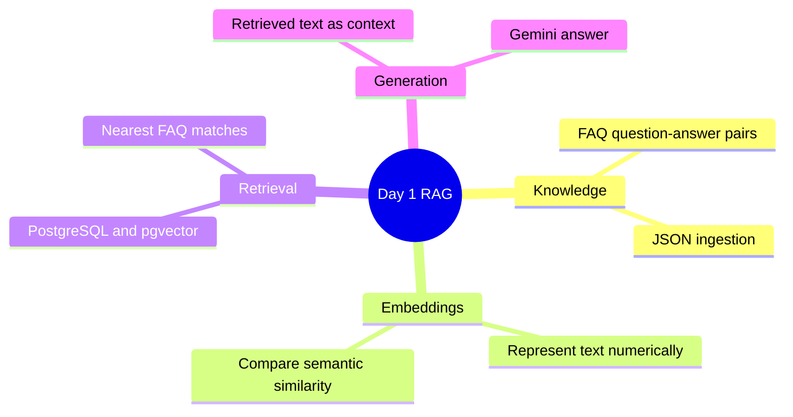

# AI FAQ Assistant

A modular PostgreSQL + pgvector + Gemini RAG project for semantic FAQ search and retrieval.

This project stores FAQ records in PostgreSQL, generates embeddings with Gemini, and performs similarity search using pgvector so users can query the knowledge base by meaning rather than exact keyword match.

<a id="contents"></a>
## Contents and day-by-day progress

| Section | Overview / progress |
| --- | --- |
| [Why this project exists](#why-this-project-exists) | Motivation for semantic FAQ search. |
| [Features](#features) | Main project capabilities. |
| [Tech stack](#tech-stack) | Languages, services, and libraries used. |
| [Project structure](#project-structure) | Repository layout. |
| [Prerequisites](#prerequisites) | Required software and credentials. |
| [Local setup](#local-setup) | Installation and configuration steps. |
| [Run the application](#run-the-application) | How to start the CLI. |
| [Data flow](#data-flow) | High-level RAG pipeline. |
| [Testing](#testing) | Test suite and how to run it. |
| [Notes for public GitHub use](#notes-for-public-github-use) | Credential and repository guidance. |
| [Development progress](#development-progress) — [Day 1](#day-1) | **Basic FAQ RAG baseline:** JSON ingestion, Gemini embeddings, PostgreSQL/pgvector semantic retrieval, and context-based answer generation through a CLI. |

## Why this project exists

Traditional keyword search fails when users ask questions with different wording than the source content. This assistant uses embeddings to convert both the FAQ and the user question into vectors and then finds the closest semantic matches in PostgreSQL.

[Back to index](#contents)

## Features

- FAQ dataset ingestion from JSON into PostgreSQL
- Gemini embedding generation for each FAQ and user question
- Gemini-generated, Markdown-formatted answers grounded in retrieved FAQs
- pgvector similarity search using cosine distance
- modular Python package structure
- CLI for ingesting data and asking questions
- production-oriented project layout for portfolio and GitHub use

[Back to index](#contents)

## Tech stack

- Python 3.13+
- PostgreSQL
- pgvector extension
- Google Gemini embeddings
- psycopg2
- Python-dotenv

[Back to index](#contents)

## Project structure

```text
ai_faq_assistant/
├── app/
│   ├── __init__.py
│   ├── config/
│   │   ├── __init__.py
│   │   └── settings.py
│   ├── domain/
│   │   ├── __init__.py
│   │   └── faq.py
│   ├── infrastructure/
│   │   ├── __init__.py
│   │   ├── database.py
│   │   ├── embedding_client.py
│   │   └── faq_repository.py
│   ├── ingestion/
│   │   ├── __init__.py
│   │   └── ingestion.py
│   ├── retrieval/
│   │   ├── __init__.py
│   │   └── retrieval.py
│   ├── services/
│   │   ├── __init__.py
│   │   ├── AI_assistant_service.py
│   │   ├── faq_ingestion_service.py
│   │   └── rag_service.py
├── data/
│   └── faqs.json
├── sql/
│   ├── 001_enable_pgvector.sql
│   ├── 002_create_faq_table.sql
│   ├── 003_vector_search.sql
│   └── 004_insert_sample_faqs.sql
├── tests/
│   └── test_core.py
├── .env.example
├── .gitignore
├── Dockerfile
├── README.md
├── main.py
├── pyproject.toml
├── requirements.txt
└── uv.lock
```

[Back to index](#contents)

## Prerequisites

Before running the project, make sure you have:

1. Python 3.13 installed
2. PostgreSQL installed and running
3. pgvector enabled in your database
4. A Gemini API key

[Back to index](#contents)

## Local setup

### 1) Clone the repository

```bash
git clone https://github.com/nandinikori/FAQ_Assistant_Using_RAG.git
cd FAQ_Assistant_Using_RAG
```

### 2) Create a virtual environment

```bash
python -m venv .venv

# Windows
.venv\Scripts\activate

# macOS/Linux
source .venv/bin/activate
```

### 3) Install dependencies

```bash
pip install --upgrade pip
pip install -r requirements.txt
```

Alternatively, with uv:

```bash
uv sync
```

### 4) Configure environment variables

Create a `.env` file in the project root based on `.env.example`:

```env
GEMINI_API_KEY=your_gemini_api_key_here
GEMINI_TEXT_MODEL=gemini-2.5-flash
DB_HOST=localhost
DB_NAME=ai_workshop
DB_USER=postgres
DB_PASSWORD=your_postgres_password
DB_PORT=5432
APP_ENV=development
```

### 5) Set up PostgreSQL and pgvector

Connect to your PostgreSQL database and enable the extension:

```sql
CREATE EXTENSION IF NOT EXISTS vector;
```

Then create the knowledge base if needed:

```sql
CREATE DATABASE ai_workshop;
```

[Back to index](#contents)

## Run the application

From the project root:

```bash
python main.py
```

The CLI menu supports:

1. Ingest FAQ data into PostgreSQL
2. Retrieve and display matching FAQs without AI generation
3. Ask Gemini to format an answer using retrieved FAQ context
4. Exit

To run the sample batch of FAQ questions and one open-ended question:

```bash
python -m app.services.AI_assistant_service
```

[Back to index](#contents)

## Data flow

```text
FAQ JSON file
    ↓
FAQIngestionService
    ↓
Gemini embedding generation
    ↓
PostgreSQL + pgvector storage
    ↓
Similarity search by embedding distance
    ↓
RAGService response generation
```

[Back to index](#contents)

## Testing

This project includes a minimal pytest suite to validate the main domain and service behavior.

```bash
pytest
```

The tests cover:

- settings validation
- FAQ record mapping
- JSON ingestion parsing
- repository insert logic
- service behavior for retrieval and answer assembly

[Back to index](#contents)

## Notes for public GitHub use

- Keep your `.env` file local and never commit secrets.
- Use `.env.example` as the template for contributors.
- Keep database credentials out of version control.
- This repository is structured as a clean demo/portfolio project rather than a throwaway notebook.

[Back to index](#contents)

## Development progress

This section records the repository's implementation as it evolves. Each entry describes capabilities present at that stage; planned capabilities are not counted as completed work.

<a id="day-1"></a>
### Day 1 — Basic FAQ RAG baseline

The starting implementation demonstrates the complete retrieval-augmented generation flow: load a knowledge source, retrieve relevant information by meaning, and provide that information to a language model to answer a question.

#### What is implemented

- **Ingestion:** load FAQ question–answer pairs from JSON and generate an embedding for each combined pair.
- **Storage:** persist FAQ content and embeddings in PostgreSQL with pgvector.
- **Retrieval:** embed the user's question and rank FAQ records using cosine distance. The retrieval interface defaults to five results; answer generation uses three.
- **Generation:** supply retrieved FAQ text to Gemini with instructions to answer from that information and avoid inventing facts.
- **Empty-context handling:** return a no-match message without generating an answer when no context is available.
- **Application structure:** separate configuration, domain models, database access, ingestion, retrieval, and application services.
- **Usage and testing:** provide an interactive CLI, a Dockerfile, setup instructions, and unit tests covering selected repository and service behavior with fake dependencies.

#### How the baseline works



#### Concept at a glance



#### What this baseline establishes

A modular implementation of one dense-retrieval RAG pattern, from data ingestion to generated answers. Each FAQ pair acts as a natural retrieval unit; document chunking is not implemented at this stage.

#### Current limitations

- Retrieval returns the nearest records without a calibrated relevance or evidence-sufficiency check. Nonempty context can still be unrelated to the question.
- Repeated ingestion can create duplicate records: the method named `upsert` currently performs inserts.
- The SQL setup and application-created schema differ; the Docker Python version also differs from the project requirement.
- Hybrid retrieval, reranking, source citations, tenant authorization, and document version management are not implemented.
- There is no published retrieval/answer-quality benchmark, production monitoring, or load-test evidence.
- Existing unit tests do not establish real database integration correctness or end-to-end answer quality. This progress entry is based on source review; no application execution or benchmark was performed for this update.

[Back to index](#contents)
