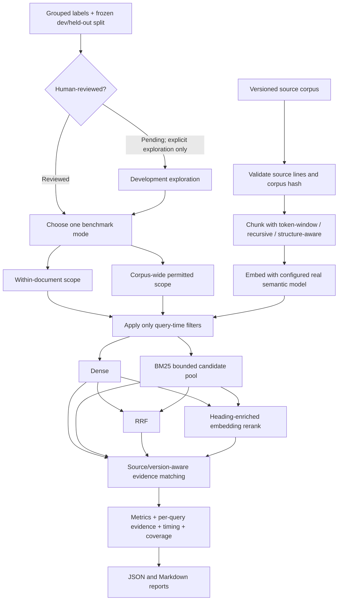

# Day 5 — Retrieval validation

## Problem

Dense similarity, BM25, reciprocal-rank fusion (RRF), and embedding-based reranking are available in the application, but the earlier eight-question experiment did not establish which chunking/retrieval pairing best recovers source evidence. Its labels were too small and lacked source coordinates, answerability, review status, a held-out split, query-time scope, and operational measurements.

Day 5 makes a controlled comparison reproducible. It does **not** claim a winning strategy, semantic quality, or completed validation until people review the labels and an authorized development run produces real measurements.

## Concept

The initial comparison holds the source corpus, embedding model/configuration, chunker parameters, candidate limit, context budget, and evidence rule constant. It compares:

| Chunking configuration | Parameters |
|---|---|
| Token-window | 80 lexical tokens, 12-token overlap |
| Recursive | 80 lexical tokens; paragraph, newline, then space separators |
| Structure-aware | 80 lexical tokens |

Each is paired with dense, BM25, RRF, and the existing heading-enriched **embedding** reranker. The reranker is not a cross-encoder: it compares query and heading-prefixed passage embeddings with cosine similarity.

Two modes are reported separately:

- **Within-document ranking**: applies the explicitly supplied document/version scope. Cases that do not have a legitimate single-document scope are excluded and counted.
- **Corpus-wide retrieval**: searches every document/version permitted by that case's query-time scope. The gold evidence is used only after ranking to score results; it is never used to construct the search filter.

The initial corpus is small and synthetic. An optional broader run can include the other existing chunkers with `--include-all-chunkers`; this is not part of the initial controlled comparison.

## Worked example

For “For FIN-022 tier B, what exact USD ceilings apply to lodging and meals?”, the gold evidence is the original source row on line 19 of `travel_expense_v1.md`. Its legitimate corpus-wide scope permits the policy collection, not just `travel-expense@1.0`. A retrieved result can satisfy this evidence unit only if its document ID and version match and its source-character span covers at least half the exact gold evidence-text span. The report records the searched versions, chunk text and coordinates, rank, evidence match, candidate-pool coverage, and timing.

For an answer requiring two distinct source passages, both are represented as separate evidence units. Evidence Recall@K counts each unit once, even if overlapping chunks cover it multiple times. `all_required_evidence_success_at_5` is 1 only when every required unit is matched in the top five; otherwise it is 0. MRR@10 is the reciprocal rank of the first matching result. It measures the first relevant result and **does not** prove complete support for a multi-passage answer.

## Implementation

### Dataset and review

`data/policies/retrieval_eval_queries.json` contains 36 question variants in 18 groups. Each group has two related variants and stays together in the frozen split: 9 groups / 18 variants in development and 9 groups / 18 variants held out. Categories include prose facts, table values and identifiers, exceptions, policy-version differences, multiple required passages, and unanswerable requests.

Each group records answerability, reference answer or expected refusal, query-time retrieval scope, and evidence labels. Positive evidence records document ID, version, original source path, one-based inclusive line coordinates, and exact source text. The loader checks evidence against the original Markdown and derives its zero-based half-open character span from the exact text. It also checks that the gold source is inside the declared permitted scope. Unanswerable groups intentionally have no positive evidence; their scope identifies the sources searched, not a fictional supporting span.

All labels currently have `pending_review` status. Group-level status applies to both variants. Before changing it to `reviewed`, a human reviewer should complete the checklist:

- [ ] Confirm the question is clear, answerable as labeled, and grounded only in the stated corpus.
- [ ] Confirm the reference answer is supported by every cited evidence unit and does not add unsupported facts.
- [ ] Confirm exact document ID, version, source path, and one-based inclusive source line coordinates.
- [ ] Confirm each evidence text matches the cited source lines and represents a necessary unit of support.
- [ ] For unanswerable cases, confirm the expected refusal is accurate for the permitted scope and that no positive gold evidence is listed.
- [ ] Confirm query-time scope is legitimate and does not depend on the gold target; for corpus-wide cases, preserve the permitted collection rather than narrowing it to the answer source.
- [ ] Confirm closely related paraphrases remain in the same split group.
- [ ] Mark the group `reviewed` only after review; never mark generated labels reviewed automatically.

The split is frozen in the dataset's `split_manifest`. The dataset and corpus SHA-256 values are included in each report. Label edits change the dataset hash; reviewers should not move groups between splits during development tuning.

### Evidence matching and metrics

Evidence matches require the exact gold document ID and version. The retrieved chunk's zero-based half-open source-character span must overlap at least **50%** of the exact evidence-text character span. Chunk coordinates from repeated table headers are included when the chunk stores original header provenance. Overlapping provenance spans are unioned so characters are not counted twice. The evidence unit is counted once at its earliest matching result. This rejects wrong-source/version matches and tiny character overlaps, while permitting partial retrieval of multi-line evidence. The rule is explicit and should be reviewed before labels are finalized.

- **Evidence Recall@5 / @10**: unique required evidence units matched in the top 5 / 10, divided by the query's required evidence count.
- **MRR@10**: reciprocal rank of the first result matching any positive evidence, or zero if none is found in the top ten. It does not measure complete multi-passage support.
- **All-required-evidence success@5**: binary success only if every required unit has a matching result in the top five.
- **Unanswerables**: counted separately and excluded from positive-evidence metrics. No refusal accuracy is inferred.

For optional parent–child runs, reports distinguish child-only ranking metrics from evidence coverage after parent expansion and the shared context-token budget. Expanded contexts are deduplicated, the budget is applied in rank order without exceeding it, and both child and expanded-context identities are retained. The same budgeted-context metrics are available for the other chunkers. The initial comparison excludes parent–child.

### Retrieval scope, configuration, and candidates

Chunk configurations are canonically serialized (sorted keys, compact JSON, UTF-8) and hashed. The complete configuration includes tokenizer identity for token windows and similarity-function identity for semantic chunking. Stateless callbacks can use a code identity; callbacks with captured/default configuration and callable instances must provide explicit stable IDs so different behavior cannot silently share an identity. Persistent retrieval can filter by strategy, complete configuration parameters, embedding configuration, and document/version scope. Configuration filters use the existing JSONB chunk metadata; no schema migration is required. Equivalent parameter mappings have the same fingerprint, and different same-strategy settings remain isolated.

Dense, BM25, RRF, and reranking share the same query-time scope, strategy, configuration, and embedding filters in application retrieval. The evaluator's corpus-wide path uses the per-case permitted document/version collection. It does not pass gold document IDs as filters.

BM25 in persistent retrieval loads at most the configured candidate limit in stable chunk-ID order before scoring. This is a bounded, potentially arbitrary subset—not complete corpus-wide lexical search. A limit-plus-one probe exposes truncation in result metadata. The benchmark reports candidate counts, limits, and incomplete coverage; a truncated run must not be described as complete corpus-wide retrieval. The in-memory initial dataset currently fits below the default candidate cap, but reports still record whether a cap was reached.

### Evaluation flow



### Reports and measurement boundaries

The default output directory is `reports/retrieval-validation/`. Both JSON and Markdown include the git revision, corpus/dataset hashes, review state, mode, searched source/version collection, chunking parameters/fingerprints, embedding configuration, candidate limit/coverage, context budget, K values, aggregate and per-query metrics, retrieved passages/evidence matches, and observed timings.

Query-embedding, first-stage retrieval/fusion, reranking, and total measured query time are separate. Chunk vectors are prepared and cached before query timers start; corpus-vector preparation has its own wall-time measurement. Total measured query time is the sum of query embedding, retrieval over precomputed vectors, and reranking; it excludes chunking, corpus-vector preparation, database setup, and report writing. Embedding calls, cache hits, and provider token usage are reported when the provider exposes it. Warm/cold cache counts are included; measurements use a single run and are not latency guarantees. Call count is not monetary cost, and the runner does not estimate cost.

The bundled pytest suite uses fake embeddings only to verify mechanics. Quality runs use real semantic embeddings and can contact the configured Gemini provider; they are never run implicitly.

## Results

**No benchmark results are available yet.** Labels are pending review, and no live development or held-out run has been executed during implementation. Consequently no default chunker or retrieval method is selected. Reports contain observed values only; never populate portfolio tables with invented measurements.

After an explicitly authorized live development run, inspect per-query failures and difficult cases in the generated report. At least three observed failures should be described only when the run actually produces them; if fewer occur, report that honestly.

## Trade-offs

- The 50% character-coverage rule is reproducible and source-aware, but reviewers must ensure evidence units are not too broad. It is not a semantic entailment judgment.
- A fixed grouped split prevents paraphrase leakage but leaves only 18 development variants; conclusions are preliminary.
- Reviewers use line coordinates in Markdown, while evaluation uses the exact character span derived from each verbatim evidence string; this avoids counting a small same-line overlap as complete evidence.
- The context budget uses the repository's deterministic lexical `token_count`, not model-token billing. It is consistent across compared methods but only an approximation of provider context size.
- The default candidate cap makes BM25 practical for the demo but can miss relevant candidates. Reports disclose truncation instead of implying full lexical coverage.
- Real embeddings provide meaningful ranking inputs but require credentials, network access, and may incur provider charges.

## Limitations

- All corpus documents are synthetic policy examples; results do not establish quality on real enterprise collections.
- Human review is outstanding for all 36 variants.
- No live development benchmark has been run, so no winner/default is justified.
- Held-out evaluation is reserved for final release and was not run here.
- PostgreSQL/pgvector isolation is covered by an opt-in integration test and remains blocked unless a configured instance is available.
- Unanswerable cases are not a refusal-accuracy benchmark.
- The reranker is embedding-based, not a cross-encoder; answer generation, corrective RAG, APIs, authorization, dashboards, and deployment are out of scope.

## Setup, review, tests, and benchmark commands

From the repository root, install the existing dependencies. The in-memory quality benchmark does not require PostgreSQL, but it does require credentials/network access only when you explicitly run it with `--run-live`. Use the `.env` setup in the main README, including `GEMINI_API_KEY` and the selected embedding model/dimension/configuration:

```powershell
python -m pip install -r requirements.txt
```

Review the dataset file and checklist above. After a human completes review for a whole group, change that group's `review_status` from `pending_review` to `reviewed`. For local validation:

```powershell
python -c "from app.retrieval.evaluation import load_evaluation_dataset; d=load_evaluation_dataset(); print(len(d.questions), d.sha256)"
python -m pytest tests/test_retrieval.py tests/test_retrieval_evaluation.py tests/test_document_storage.py -q
python -m pytest -q
```

PostgreSQL/pgvector integration is opt-in and requires a configured database:

```powershell
$env:RUN_POSTGRES_INTEGRATION_TESTS = "1"
python -m pytest tests/integration/test_document_postgres.py -q
Remove-Item Env:\RUN_POSTGRES_INTEGRATION_TESTS
```

There is deliberately **no automatic API benchmark**. After review, explicitly authorize real development-only embedding calls and run:

```powershell
python -m app.retrieval.evaluation --run-live --mode corpus-wide --split dev
```

To explore pending labels before review, explicitly use the exploratory flag:

```powershell
python -m app.retrieval.evaluation --run-live --mode corpus-wide --split dev --exploratory
```

`--run-live` is mandatory to construct the Gemini provider and make calls. The held-out split is rejected unless final release is explicitly authorized with `--split held_out --confirm-held-out`; do not use that command during development. For within-document measurement, replace `--mode corpus-wide` with `--mode within-document`; these results answer a different retrieval task and must not be compared as if corpus-wide.

After human review and only for the final release, the explicit held-out command is:

```powershell
python -m app.retrieval.evaluation --run-live --mode corpus-wide --split held_out --confirm-held-out
```

Do not run this held-out command during development or tuning. Held-out runs reject pending labels even when the exploratory flag is requested. The same confirmation and reviewed-label safeguards are enforced by the Python evaluation function, not only by the CLI.
